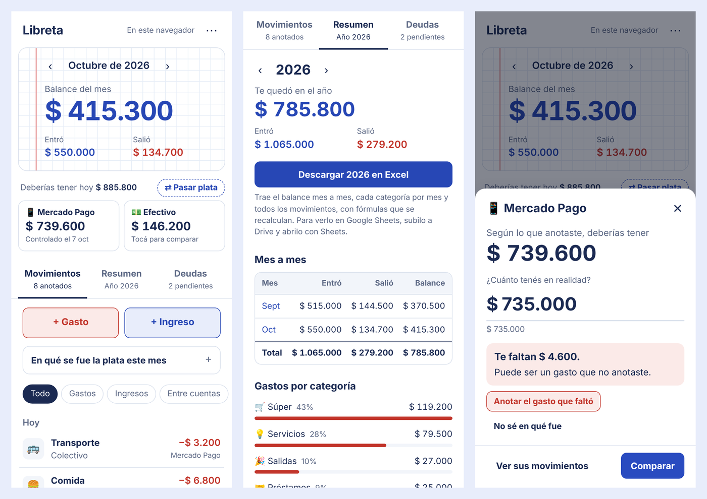

# 📒 Libreta de cuentas

App web para controlar ingresos, gastos y deudas desde el celular. Se instala como una app, funciona sin conexión y **los datos quedan en tu dispositivo**, salvo que elijas sincronizarlos con tu cuenta de Google.

**▶ Probala:** https://alanvillar05.github.io/control-de-gastos/



## Funcionalidades

- **Ingresos y gastos** con categorías propias (nombre e ícono), que se crean desde el mismo formulario.
- **Anotar hablando:** tocás 🎤, decís por ejemplo *"gasté 2500 de nafta con Mercado Pago"* y el formulario se completa solo (tipo, monto, cuenta, categoría y fecha) para que lo revises antes de guardar. Entiende "lucas", "mil", "con 50" (centavos), "ayer", "el lunes" o "el 5", pases entre cuentas y guardar en una meta de ahorro.
- **Varias cuentas** (Mercado Pago, efectivo y las que agregues), con el saldo que deberías tener y pases de plata entre cuentas que no cuentan como ingreso ni como gasto.
- **Control contra el saldo real:** ingresás cuánto tenés de verdad y la app te dice si falta o sobra plata, y te ayuda a anotar la diferencia.
- **Ahorros:** metas con objetivo y fecha, plata que se guarda y se saca desde las cuentas, y cuánto falta por mes para llegar.
- **Deudas:** lo que debés y lo que te deben, con pagos parciales y vencimientos. Si pusiste plata vos, se descuenta de la cuenta y vuelve a entrar al registrar el cobro.
- **Resumen anual** mes a mes y por categoría, con **exportación a Excel** (las fórmulas se recalculan si editás la planilla).
- **Sincronización con Google** (opcional): iniciás sesión desde **⋯ › Sincronizar con Google** y usás la misma libreta en el celular, la compu o donde quieras. Sin internet sigue andando y sube los cambios cuando vuelve la conexión.
- **Copia de seguridad** en `.json`, restauración y botón de deshacer al borrar.
- Modo oscuro automático e instalación en la pantalla de inicio.

## Privacidad

Si no iniciás sesión, no hay servidor ni base de datos compartida: cada persona guarda lo suyo en el almacenamiento de su navegador (`localStorage`), así que nadie más puede verlo. La contra: si se borran los datos del navegador, se pierde lo anotado, por eso conviene descargar una copia de seguridad cada tanto desde **⋯ › Descargar copia de seguridad**.

Si iniciás sesión con Google, la libreta se guarda en Firestore (la base de datos de Firebase, un servicio de Google) dentro de un espacio que solo tu cuenta puede leer y escribir. Lo garantizan las reglas de seguridad de [`firestore.rules`](firestore.rules), no la app. Al cerrar sesión, la copia del dispositivo se borra y la libreta queda en tu cuenta.

Al usar la sincronización, la página carga reCAPTCHA de Google para App Check: comprueba que quien le habla a la base es la app y no un programa automático.

**Anotar hablando:** el navegador manda el audio de esa frase a su servicio de reconocimiento de voz (en Chrome, el de Google) para pasarlo a texto.

## Decisiones técnicas

| Decisión | Por qué |
|---|---|
| Montos guardados en **centavos enteros** | En JavaScript `0.1 + 0.2` da `0.30000000000000004` (coma flotante). Con enteros, las sumas de plata son exactas. |
| HTML, CSS y JavaScript **en un solo archivo, sin frameworks** | No necesita compilación: se publica tal cual y es fácil de mantener. |
| Categorías y cuentas referenciadas **por id**, no por nombre | Renombrar una categoría actualiza todo el historial sin romper nada. |
| **PWA** (*Progressive Web App*) con *service worker* "red primero" | Con internet siempre carga la última versión publicada; sin conexión usa la copia guardada. |
| Voz con la **Web Speech API** del navegador y un intérprete propio (`interpretarFrase`) | Gratis y sin servidor ni claves. Usa las categorías y cuentas de cada persona. En Firefox no existe, así que ahí el botón 🎤 no aparece. |
| Sincronización con **Firebase** (Auth con Google + Firestore), cargado solo si iniciás sesión | Trae resuelto el modo sin conexión y la actualización en tiempo real. Cada mes es un documento con un mapa `id → movimiento`, y solo se manda lo que cambió: dos celulares que anotan en el mismo mes no se pisan. |
| La configuración de Firebase está **en el código, a la vista** | Es pública por diseño: identifica el proyecto, no da permisos. Lo que protege los datos son las reglas de seguridad. Además, la clave está restringida a este sitio en la consola de Google Cloud. |
| **App Check** con reCAPTCHA invisible | Firebase solo atiende pedidos que vienen de esta página, no de un programa que copie la configuración. Protege la cuota gratis; los datos ya los protegen las reglas. |
| **ExcelJS** cargado solo al exportar, con su huella (**SRI**, *Subresource Integrity*) | La app abre rápido; la librería se descarga únicamente cuando hace falta. La huella hace que el navegador la rechace si alguien la modificara en el CDN (el sitio de donde se baja). |
| **CSP** (*Content Security Policy*) agregada al publicar | Es la lista de sitios desde donde la página puede cargar código y a cuáles puede mandar datos. Si alguien lograra meter código en la página, el navegador no lo ejecuta. Como el código de la app está dentro de `index.html`, la CSP lleva su huella (un *hash* SHA-256), que cambia con cada edición: por eso la calcula [`.github/csp.py`](.github/csp.py) al publicar y no se escribe a mano. GitHub Pages no deja configurar cabeceras, así que va como etiqueta `<meta>`. |

## Estructura

| Archivo | Para qué sirve |
|---|---|
| `index.html` | La app completa. |
| `manifest.webmanifest` | Nombre, colores e íconos para instalarla como app. |
| `sw.js` | *Service worker*: permite abrirla sin conexión (también guarda Firebase para la libreta sincronizada). |
| `firebase.json` | Configuración para los emuladores de Firebase (pruebas en la compu). |
| `firestore.rules` | Reglas de seguridad de la base de datos: cada persona solo accede a lo suyo. Se pegan en la consola de Firebase. |
| `icon-192.png`, `icon-512.png`, `apple-touch-icon.png` | Íconos de la app. |
| `capturas/` | Imágenes de este README. |
| `.github/workflows/publicar.yml` | Publica `main` y `dev` (en `/beta/`) en GitHub Pages en cada push. |
| `.github/csp.py` | Le agrega la CSP a `index.html` al publicar. Cada rama usa el suyo, así un cambio de la CSP se prueba primero en la beta. |
| `.nojekyll` | Evita el procesamiento con Jekyll si alguna vez se publica directo desde una rama. |

## Probarla en la compu

El *service worker* no funciona abriendo el archivo con doble clic (`file://`), así que hay que servirla con un servidor local:

```bash
python3 -m http.server 8000
```

Y abrir http://localhost:8000.

Así se abre **sin la CSP**, que se agrega recién al publicar. Para probar con la CSP, aplicarla a una copia: `python3 .github/csp.py copia/index.html`.

## Cómo se trabaja: ramas y versión de prueba

| Rama | Se publica en | Para qué |
|---|---|---|
| `main` | https://alanvillar05.github.io/control-de-gastos/ | Versión estable, la que usa todo el mundo. |
| `dev` | https://alanvillar05.github.io/control-de-gastos/beta/ | Versión de prueba para revisar los cambios antes de lanzarlos. |

1. Los cambios se hacen y se suben a `dev`. El workflow `.github/workflows/publicar.yml` los publica en `/beta/` en unos minutos.
2. Se prueban en la beta. Lo que se anota ahí se guarda aparte, así que no toca los datos reales.
3. Si está todo bien, se abre un *pull request* de `dev` a `main` y se acepta (*merge*). Esa es la versión que les llega a todos la próxima vez que abran la app con internet.

Cada versión nueva sube el número de `VERSION` en `index.html` y, si hay algo para contarle a quien la usa, agrega una entrada en `NOVEDADES`: la app se las muestra a cada persona una sola vez después de actualizar. Si se modifican `sw.js`, el manifest o los íconos, también hay que subir `VERSION_CACHE` en `sw.js` para que los celulares descarten la copia vieja.

> GitHub Pages tiene que estar configurado con **Settings › Pages › Source: GitHub Actions**.

## Probar la sincronización sin tocar la base real

Con los [emuladores de Firebase](https://firebase.google.com/docs/emulator-suite) (necesitan Node y Java):

```bash
npx firebase-tools emulators:start --only auth,firestore --project demo-libreta
```

Y abrir http://localhost:8000/?emulador . Para iniciar sesión alcanza con escribir cualquier mail: es una cuenta de prueba.

## Limitaciones conocidas

- Sin iniciar sesión, cada navegador tiene su propia libreta. Para pasarla de uno a otro sin cuenta de Google, usar la copia de seguridad.
- Para iniciar sesión se abre una ventana de Google: si el navegador bloquea las ventanas emergentes, hay que permitirlas.
- Exportar a Excel requiere conexión, porque la librería se descarga en ese momento.

## Licencia

[MIT](LICENSE) © [alanvillar05](https://github.com/alanvillar05)
